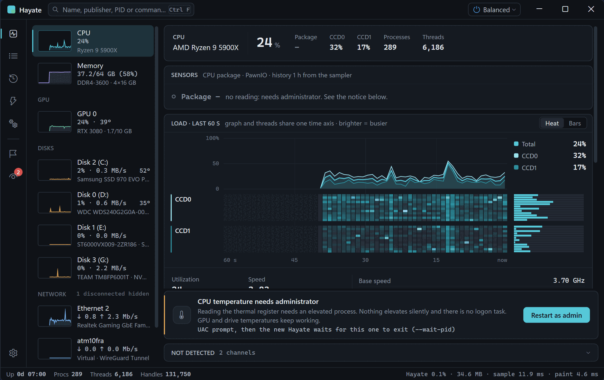
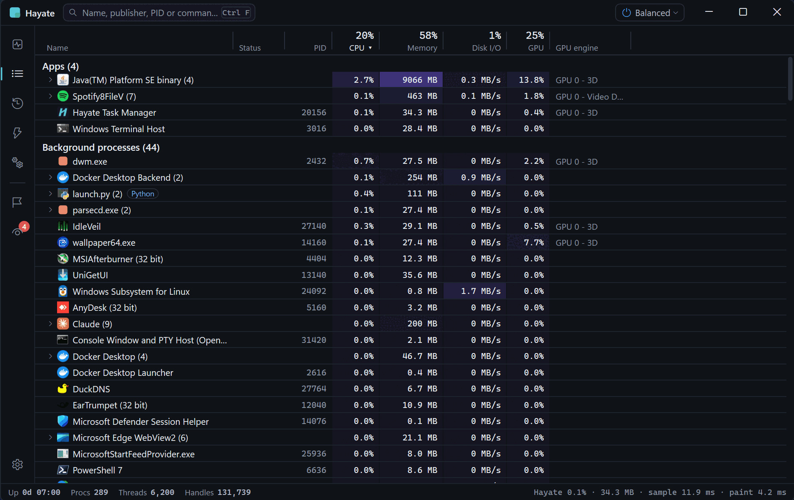
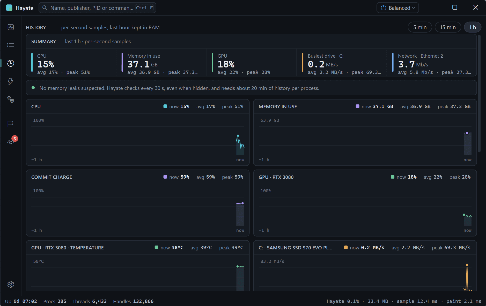
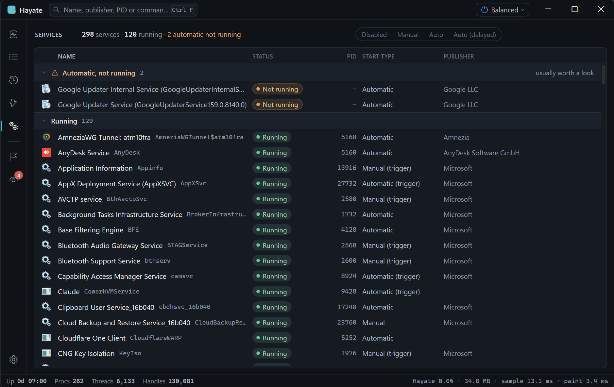
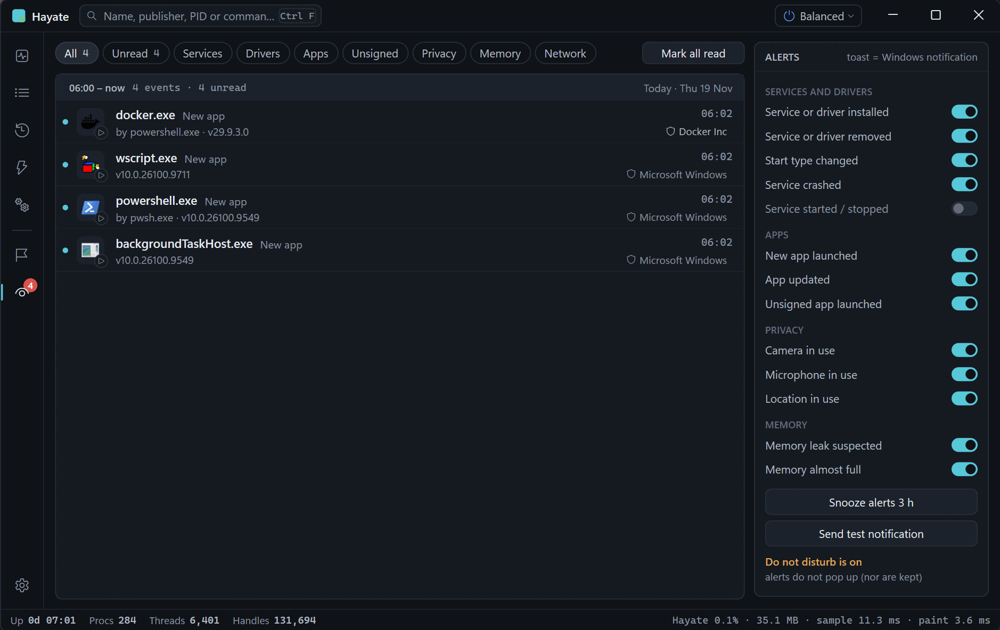
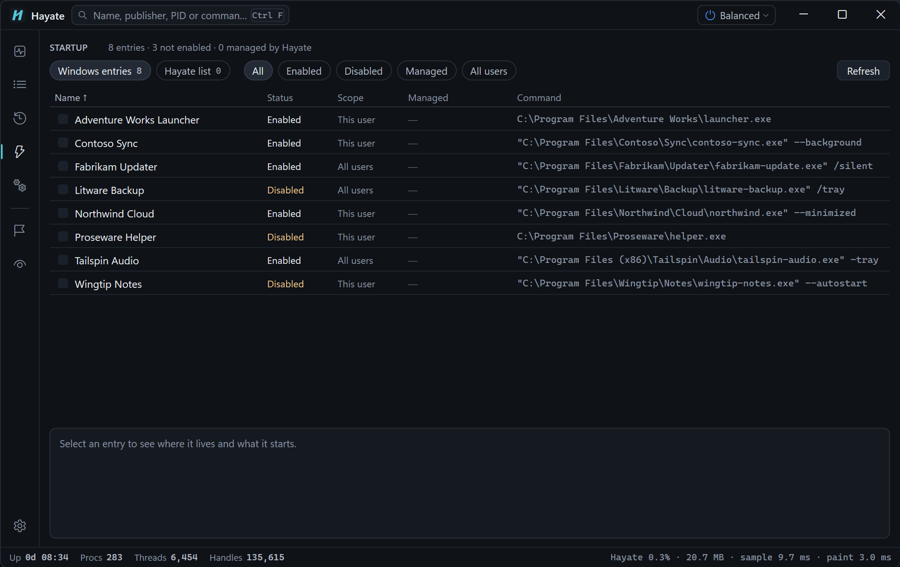
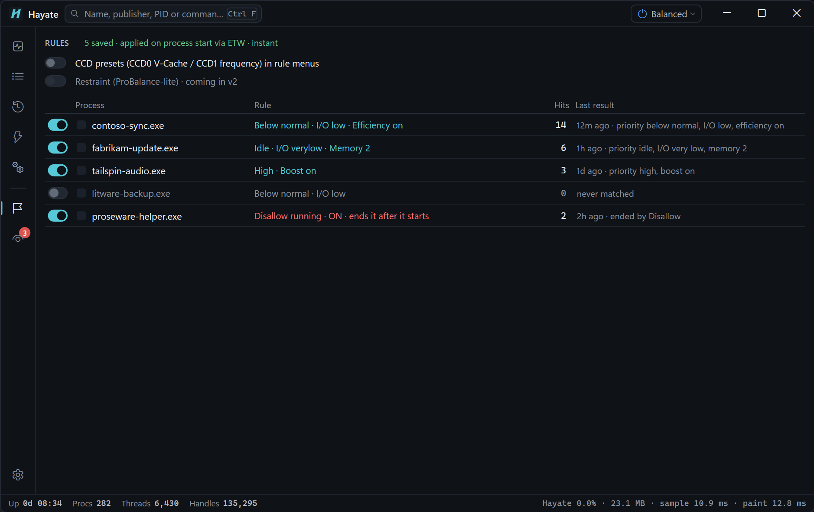

<p align="center">
  
</p>

<p align="center"><strong>A fast, light system monitor and task manager for Windows.</strong></p>

<p align="center">
  Rust · Win32 · Direct2D · a single exe · no runtime, no installer required
</p>

<p align="center">
  <a href="https://github.com/watdafawx/hayate/releases/latest"></a>
  <a href="LICENSE"></a>
  
</p>

<p align="center">
  
</p>

## What it is

Hayate (疾風, "swift wind") is a Task Manager replacement and system monitor. It is one native Windows
executable written in Rust that draws its own UI with Direct2D (GPU-rendered, with a software fallback).
It stays small when hidden in the tray and opens instantly when you need it.

It does the usual job (what is running, what is eating CPU, memory, disk, GPU and network) and adds the
things you normally need three other tools for: per-core CPU heat, sensors, an hour of history, a startup
manager that can delay and gate programs, a services manager, per-program rules, and alerts when something
new or odd shows up.

It is an actively developed project. Download the latest build from the [releases page](https://github.com/watdafawx/hayate/releases/latest) (see [Install](#install)).

## Screenshots

<table>
  <tr>
    <td width="50%"><a href="docs/screenshots/processes.png"></a><br><sub><b>Processes</b>: grouped, expandable, per-process CPU, memory, disk and GPU.</sub></td>
    <td width="50%"><a href="docs/screenshots/history.png"></a><br><sub><b>History</b>: last hour per second, summary strip, leak suspects. (Freshly launched here, so the charts are short.)</sub></td>
  </tr>
  <tr>
    <td width="50%"><a href="docs/screenshots/services.png"></a><br><sub><b>Services</b>: state, PID, start type, publisher; "automatic but not running" first.</sub></td>
    <td width="50%"><a href="docs/screenshots/watch.png"></a><br><sub><b>Watch</b>: new apps, service and driver changes, privacy and memory alerts.</sub></td>
  </tr>
  <tr>
    <td width="50%"><a href="docs/screenshots/startup.png"></a><br><sub><b>Startup</b>: what starts with your session, from Run keys and Startup folders. (Sample data.)</sub></td>
    <td width="50%"><a href="docs/screenshots/rules.png"></a><br><sub><b>Rules</b>: per-process settings applied when a matching process starts. (Sample data.)</sub></td>
  </tr>
</table>

## Features

**Monitor**
- **Vitals**: device list (CPU, memory, GPU, disks, network adapters) with live graphs. CPU detail has a
  per-core heat map grouped by CCD and a Heat/Bars toggle. Memory, GPU, disk and network have their own
  detail panels. Network adds LAN/WAN/total graphs, per-app Down/Up (needs admin, ETW), and a health panel
  (errors, discards, retransmits, Wi-Fi, link flaps).
- **Sensors**: GPU temperature, fan and power, drive temperatures, and CPU package temperature on AMD Zen
  CPUs via [PawnIO](https://pawnio.eu/) (not bundled; needs admin). Without PawnIO or admin the other
  sensors keep working. See [docs/sensors.md](docs/sensors.md).
- **Processes**: Apps / Background / Windows groups, expandable children, column picker, search, live values
  with a stable, slow reorder so rows do not jump under the mouse.
- **History**: per-second charts for the last hour (5 min / 15 min / 1 h), a summary strip, synced crosshair,
  and memory-leak suspects. It lives in RAM only.

**Manage**
- **Startup**: every Windows startup entry in one list, with enable/disable. An optional Hayate-managed
  list can start programs at sign-in with a **delay**, an **"after" dependency** and a **CPU gate**
  (start when CPU is below N %; it gives up after 90 s and starts anyway).
- **Services**: right-click Start / Stop / Restart and startup type (Automatic, Delayed, Manual, Disabled),
  plus a Properties panel. Windows service permissions decide what is allowed; nothing elevates
  silently. See [docs/services.md](docs/services.md).
- **Rules**: per-program rules applied when a matching process starts: priority, CPU affinity and CPU sets,
  efficiency mode and priority boost, with opt-in CCD presets. **Disallow running** ends a matching program after it starts, only while Hayate
  runs; it is not launch prevention or a security control ([docs/disallow.md](docs/disallow.md)).
- **Process actions**: right-click menus on process rows and on the Top lists in Vitals.

**Watch**
- New apps, app updates, unsigned apps, service and driver changes, service crashes, camera / microphone /
  location use, memory leaks and memory pressure, with Windows toasts, filters, per-alert toggles and snooze.

**Integration**
- **Task Manager replacement (opt-in, off by default)**: Ctrl+Shift+Esc and other Task Manager launches open
  Hayate instead. Needs an installed copy and a UAC prompt; hold **Shift** to get the real Task Manager.
  Details and recovery: [docs/task-manager-replacement.md](docs/task-manager-replacement.md).
- **Tray** icon, taskbar Jump List (Open / Processes / Vitals / Restart as admin) on installed copies, and an
  optional snippet for the Nilesoft Shell empty-taskbar menu ([docs/taskbar.md](docs/taskbar.md)).
- **Auto-update (opt-in)** from a local folder you point it at. It does not download anything from the
  internet; it verifies the hash, swaps itself, and rolls back if the new build does not start.

## Install

Hayate is a single exe (`blink.exe`, see [Name](#name)). Windows 10 and 11 are declared in the manifest; it is
developed and tested on Windows 11. There is no winget or Store package yet. Download `blink.exe` from the
[latest release](https://github.com/watdafawx/hayate/releases/latest), or build it yourself ([Building](#building-from-source)).

Run the exe. A portable copy offers three choices in a banner at the top:

| Choice | What it does |
|---|---|
| **Install just for me** | Copies Hayate to `%LOCALAPPDATA%\Programs\Blink`, adds Start menu entries (**Hayate** and **Hayate (admin)**) and an Installed apps entry. No admin needed. |
| **Install for everyone** | In Settings → Install. Installs to `C:\Program Files\Blink` for all users; UAC prompt. |
| **Run without installing** | Runs the exe in place. Nothing is written: no shortcuts, no registry, no autostart. |

Optional extras in the same dialog: start with Windows (hidden in the tray, never elevated) and update source.

Scripted install, from a checkout with a built exe:

```powershell
pwsh -File install.ps1                # per-user, no admin
pwsh -File install.ps1 -Machine       # per-machine, from an elevated terminal
pwsh -File install.ps1 -Autostart     # also start hidden at sign-in
pwsh -File install.ps1 -UpdateFrom <folder>   # auto-update from a publish drop folder
```

## Uninstall

Any one of these:

1. In Hayate: **Settings → Install → Uninstall Hayate…**
2. Windows **Settings → Apps → Installed apps → Hayate → Uninstall**
3. `pwsh -File install.ps1 -Uninstall` (removes the per-user and/or machine install)

Uninstall also gives back any Windows startup entries Hayate switched off, and turns the Task Manager
redirect off first if it was on.

## Usage tips

- **Ctrl +** / **Ctrl -** / **Ctrl 0** (or Ctrl + mouse wheel): zoom in, out, reset. Also in Settings.
- **Ctrl+F**: focus search. It filters the current list.
- **Right-click** rows: process, service and Top-list menus have the actions (end, priority, affinity,
  rules, copy PID, Show in Processes, and so on).
- **Hover** a row or chart for details; lists freeze while you hover or scroll so you can click what you see.
- Started with `--resident`, closing the window hides Hayate to the tray; launch it again to show it.
  Clicking the tray icon toggles the window.
- **Shift** held at launch bypasses the Task Manager redirect and opens the real Task Manager.
- **Stuck redirect?** Settings → *Open Hayate instead of Task Manager* → off. If Hayate will not start, run
  the exact `reg delete` line at the end of [docs/task-manager-replacement.md](docs/task-manager-replacement.md)
  from an elevated prompt.

## Safety and privacy

- **No telemetry.** Hayate has no HTTP client and makes no internet connections of its own. (The "Install PawnIO" button runs `winget` after a UAC
  prompt; that is winget talking to its source, not Hayate.) Data it
  keeps (settings, rules, logs, startup list, alert events) stays in `%LOCALAPPDATA%\Blink`. The optional
  network-health probes (one ICMP echo, DNS lookups, one TCP connect attempt) are off by default and only
  run while the window is visible; "Test this host" is click-only.
- **What it reads:** process, service and driver lists, performance counters, GPU and drive sensors,
  the Windows event log, camera/microphone/location consent state, and per-app network *metadata*
  (bytes, connects, failures) through ETW when elevated. No packet contents, and per-app traffic rates are
  not stored. Connection-failure incidents shown in Watch (app name, remote ip:port, exe path) are kept
  locally for 30 days.
- **Admin only when you ask.** Hayate runs as a normal user. Features that need admin (CPU temperature,
  per-app network, acting on other users' processes) say so and offer **Restart as admin** with a UAC prompt.
  Nothing elevates silently and there is no logon task for it.
- **The Task Manager redirect is opt-in and UAC-gated.** It writes one machine-wide registry value, installs
  a protected launcher in Program Files, checks it first, and falls back to the real Task Manager on Shift
  or any failure. Read the research note before enabling it.
- **Disallow and affinity rules** act on processes with Hayate's own rights, can lose unsaved work in the
  target program, and only run while Hayate runs.
- Builds are not code-signed, so SmartScreen may warn on first run.

## Building from source

Requirements: Windows, the stable Rust toolchain with the MSVC target, and the Visual Studio Build Tools
(MSVC and a Windows SDK).

```powershell
cargo build --release
cargo test --release
```

The binary is `target\release\blink.exe` (LTO, stripped). For the auto-update flow, put `blink.exe`, `blink.exe.sha256` and `version.txt` in one folder.


## Name

**Hayate** (疾風) means "swift wind". The project began as *Blink*, so the executable, the crate, the data
folder (`%LOCALAPPDATA%\Blink`), the Start menu folder paths and the scripts are still called `blink`. The
window, shortcuts and Installed apps entry say Hayate. Brand notes are in [docs/brand.md](docs/brand.md).

## License

MIT, see [LICENSE](LICENSE). The brand assets (name, logo) are covered by the same license; the wordmark text is outlined (no font needed at runtime) from Barlow Semi Condensed and Noto Sans JP, both under the SIL Open Font License 1.1; see [assets/brand/fonts/NOTICE.md](assets/brand/fonts/NOTICE.md).
